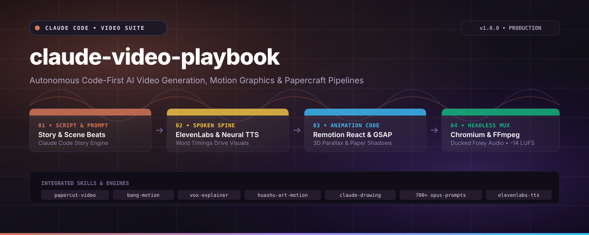

# claude-video-playbook

> Production playbook and engine for programmatic AI video creation with Claude Code.

```bash
git clone https://github.com/atharhive/claude-video-playbook.git && cd claude-video-playbook && pip install -r requirements.txt
```



<p align="center">
  <a href="https://github.com/atharhive/claude-video-playbook/actions/workflows/ci.yml"></a>
  <a href="https://opensource.org/licenses/MIT"></a>
  <a href="https://code.claude.com"></a>
  <a href="https://remotion.dev"></a>
  <a href="https://elevenlabs.io"></a>
  <a href="https://ffmpeg.org"></a>
  <a href="https://github.com/atharhive/claude-video-playbook"></a>
  <a href="https://github.com/atharhive/claude-video-playbook"></a>
</p>

## Overview

Claude Video Playbook is an autonomous, code-first video production pipeline designed for developers and AI coding agents. Instead of editing timelines manually or relying on unpredictable generative video models, every scene is authored in code, synchronized to spoken audio, and rendered headlessly.

### Key Capabilities

- **Spoken-Spine Timing**: Audio stems and word-level timestamps dictate scene transitions and camera movements.
- **Papercut Remotion Engine**: Layered 3D camera tracks, tactile paper textures, and kinetic subtitles in React.
- **Browser Motion Graphics**: Cinematic openers and typography using GSAP, Three.js, and CSS.
- **700+ Production Recipes**: Curated database of proven viral video prompts for Claude Opus 5.5.
- **Multi-TTS Pipeline**: Seamless integration with ElevenLabs and neural Edge TTS.

## Architecture & Workflow

```
1. Script & Beats      2. Vocal Stems         3. Code Animation      4. Headless Mux
   (Claude Code)   --> (ElevenLabs / TTS) --> (Remotion / GSAP)  --> (Chromium + FFmpeg)
```

<details>
<summary><b>Expand Architecture & Component Details</b></summary>

### 1. Spoken Spine Principle
Visual pacing without audio often fails. We generate audio stems first to extract exact millisecond timestamps per word:
- `scripts/build_voiceover.py` consumes `narration/script.json`.
- Words are weighted by character count and aligned to vocal duration.
- Timings are exported to `timing_narrator.js` to drive animation keyframes.

### 2. Supported Motion Frameworks
- **Remotion**: Programmatic React components with spring physics (`useCurrentFrame`, `interpolate`, `spring`).
- **Bang Motion**: Canvas, SVG, and GSAP motion graphics rendered as standalone web apps.
- **Huashu Art Motion**: 36+ artistic styles including ink wash, retro gouache, and oil impasto.
- **Claude Drawing**: Procedural stroke-by-stroke illustration using Pillow and NumPy without image generation models.

### 3. Audio Normalization & Foley
- Integrated sidechain ducking lowers background music under active dialogue.
- Foley sound effects (paper rustles, tape cuts, keyboard clicks) trigger on key actions.
- Output normalized to broadcast standards (-14 LUFS).

</details>

## Quick Start

### 1. Search Video Recipes
Use the built-in search tool to find prompts from over 700 production videos:

```bash
python scripts/find_video_prompt.py "kinetic typography"
python scripts/find_video_prompt.py "3d" --limit 3
python scripts/find_video_prompt.py "explainer" --category explainer
```

### 2. Generate Narration
Generate speech stems using ElevenLabs or free Edge TTS:

```bash
# Using free neural TTS
python scripts/build_voiceover.py --script examples/01-claude-launch/narration/script.json --provider edge

# Using ElevenLabs
export ELEVENLABS_API_KEY="your-key-here"
python scripts/build_voiceover.py --script examples/01-claude-launch/narration/script.json --provider elevenlabs --voice "TX3LPaxmHKxFdv7VOQHJ"
```

### 3. Render Example Composition
```bash
cd examples/01-claude-launch
npm install
npx remotion render src/index.ts ClaudeLaunch out/video.mp4
```

<details>
<summary><b>Expand Documentation & Reference Guides</b></summary>

- [Architecture Guide](docs/architecture.md): In-depth review of the code-to-video compilation process.
- [Production Runbook](docs/runbook.md): Headless Linux VPS rendering commands and troubleshooting.
- [Show HN Post Draft](docs/show-hn.md): Launch narrative and benchmark performance summary.
- [Example 01 Walkthrough](examples/01-claude-launch/README.md): Complete scene breakdown of the Claude launch video.

</details>

## License & SLA

- **License**: MIT License. See [LICENSE](LICENSE) for details.
- **Maintainer SLA**: 24-hour response time on all issues, pull requests, and discussions.
